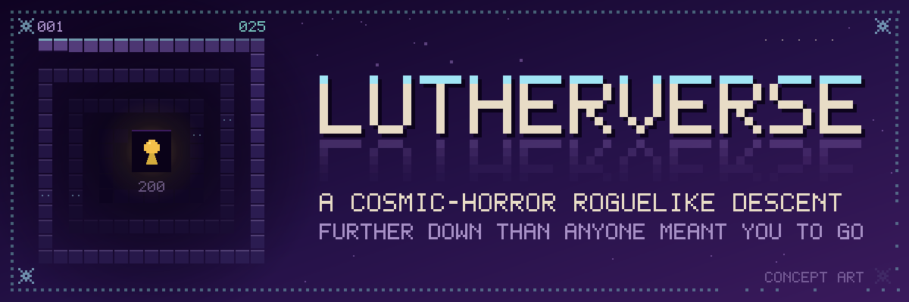

<p align="center">
  
</p>

<h1 align="center">Lutherverse</h1>

<p align="center">
  <em>A roguelike descent planned for 200 floors. Shattered's ends at a god. This one keeps going.</em>
</p>

<p align="center">
  <sub>In Shattered's prison, the warden's last letter tells a guard to lock one cell, throw the key into an alcove and get out. Somebody has to carry the keys.</sub>
</p>

<p align="center">
  <a href="https://github.com/luther-rotmg/Lutherverse/actions/workflows/ci.yml"></a>
  <a href="LICENSE.txt"></a>
  
  
</p>

<p align="center">
  <a href="#001--what-this-is">What this is</a> ·
  <a href="#002--whats-down-there-now">Playable now</a> ·
  <a href="#003--house-rules">House rules</a> ·
  <a href="#004--further-down">The plan</a> ·
  <a href="#008--building-it-yourself">Build it</a> ·
  <a href="docs/THEME.md">Theme bible</a>
</p>

> *The ghost of a prison jailer, still making rounds it no longer remembers.*
>
> <sub>keywraith, floor 3. That line is in the game right now.</sub>

**Try it:** there's no release yet. You can build it from source ([008](#008--building-it-yourself)) and start a run as the Keybearer.

---

## 001 · What this is

Lutherverse is a roguelike about going further down than anyone meant you to.

It's a fork of [Custom Pixel Dungeon](https://github.com/QuasiStellar/custom-pixel-dungeon), which is itself a fork of [Shattered Pixel Dungeon](https://github.com/00-Evan/shattered-pixel-dungeon). Shattered gives you 25 floors of tight, replayable dungeon crawling, and at the bottom is an Old God with a name: Yog-Dzewa, the thing the dwarves have been trying to keep contained. Custom Pixel Dungeon adds a pack-based modding framework on top. I'm building toward 175 more floors underneath that god. Two hundred floors is about eight times what Shattered ships, and nobody has been to the bottom, including me.

Right now nobody can. The dungeon on `main` still ends where Shattered's does, at Yog-Dzewa on floor 25 with the Amulet one floor below. The rest is the plan.

The mood is cosmic horror, and the horror I'm after is scale and indifference. Most of the dungeon barely notices you. The thing at floor 25 does, and it's the last thing down there with a name.

The pixel art stays cute on purpose. The keywraith is a friendly little sprite with a dark hood and two points of light where its face should be, and to me that's more unsettling than gore.

Written in Java on libGDX. GPLv3, like everything it's built on. Formerly `CustomPixelDungeonUltimate`; the old links redirect. I want it to be the kind of project a small group of people obsess over for a long time.

---

## 002 · What's down there now

Most of this README is about where the project is going. This section is only what's on `main` and playable if you build it yourself.

### The Keybearer

*A prototype hero class. The game labels it "Prototype" itself, and it means it.*

The Keybearer is the only character in the dungeon whose job is opening things. Every original creature down there is trying to keep something shut.

| Feature | What it does |
|---|---|
| **Kit** | Always unlocked. Starts with the fire keyblade in hand, the frost keyblade in the off-hand and the storm keyblade in the pack. |
| **True dual-wield** | The off-hand keyblade strikes on every hit too, at half its damage roll, with its own elemental effect. Keybearer only, so no other class changes. |
| **Three keyblades** | Fire sets targets burning and frost chills and slows, from the first swing. Storm adds shock damage that arcs into an adjacent enemy once its sphere-grid nodes are active. |
| **Keyblade nova** | One of three armor abilities on offer once the Dwarf King's crown upgrades your armor (the other two are borrowed from the Warrior). It hits every enemy within 4 tiles that a wall isn't hiding, and ignites, chills or shocks them depending on which element your build leans on, and hits harder the more of the grid you've invested in. |
| **Sphere grid** | 20 nodes rooted at Attunement, with Ember, Frost and Storm branches (capped by Conflagration, Permafrost and Tempest) plus Might, Vigor and Ability. The keystone, Elemental Conflux, needs Ember II, Frost II and Storm II. It's shown as a plain list for now; the web comes later. |
| **Insight** | Every node starts locked. Spending 1 Insight unlocks one for good, and run points activate it each descent. Insight comes from Keybearer level-ups and from shattering an insight crystal. It carries over between runs, and nothing in the game takes it back. |

### The residents

The first original creatures down there are what's left of a prison's staff and equipment: a jailer's ghost, a tax-collector's shade, a carved doorkeeper, a moth fat on ward-dust and a stray spark of lock-magic. They spawn in the default dungeon's Sewers and Prison floors, and each one has unit tests.

- **tumbler wisp**, floor 2. Flies, dodges, and blinks away when wounded.<br>
  <sub>*"A flittering mote of locksmith's magic, escaped from some long-broken mechanism."*</sub>
- **keywraith**, floor 3. Its touch cripples you, briefly locking your joints.<br>
  <sub>*"A single golden key hangs from its wispy grip"*</sub>
- **hexward moth**, floor 4. Its touch causes vertigo.<br>
  <sub>*"A moth grown fat on warding-hex dust."*</sub>
- **wardstone sentinel**, floor 6. Slow and heavily armoured.<br>
  <sub>*"An animated block of warded lockstone, carved into a crude keeper of doors that no longer exist."*</sub>
- **gaol shade**, floor 7. Steals gold on every hit.<br>
  <sub>*"The Keywraith's crueler kin: the shade of a gaol tax-collector who never stopped collecting."*</sub>

They're doing their jobs, and you're standing in the way.

Shattered's warden left a journal, so you can find out who was locked up in the prison. The original text leaves a different question open. The sentinel keeps doors that no longer exist, and the keywraith's key is "the last one it ever turned". Neither says what was on the other side, and the game isn't going to tell you.

### Two stones

- **warden's sigil**, a runestone you throw. It cripples whatever it lands on (half movement speed) and briefly cripples the enemies beside it.<br>
  <sub>*"A flat stone graven with a gaol-warden's binding sigil."*</sub>
- **insight crystal**, a runestone that gives +1 Insight, permanently, to whoever shatters it.<br>
  <sub>*"Shatter it and the insight lingers"*</sub>

Any class can shatter an insight crystal, and the Insight is banked for your next Keybearer run. Only the Keybearer can spend it.

### Everything else

Shattered's full dungeon by way of Custom Pixel Dungeon, plus CPD's pack framework and the 29 community packs mirrored under [`marketplace/`](marketplace/) (see [009](#009--other-peoples-dungeons)).

---

## 003 · House rules

> *I am opening something I should not, and I keep getting better at it.*

That's the feeling I'm after, and these are the rules I'm writing toward. The longer version, with tone, naming and palette, is in the [theme bible](docs/THEME.md).

1. **The bottom is never shown.** Shattered names its god at floor 25. The plan runs 175 floors past that, and whatever is further down gets no name, no portrait and no lore book that explains it.
2. **Containment is failing, quietly.** Wards, gaols, sigils, locks. A ward still glowing over an empty cell is scarier than a broken one. Shattered already says the dwarves have been trying to keep their god contained.
3. **Knowledge is permanent.** What you learn can't be unlearned, and it comes back down the stairs with you after every death.
4. **Indifference over malice.** The original residents hurt you because you're in the way. The one thing down there that really sees you is the last thing with a name.
5. **Repetition is the haunting.** The dead down here keep repeating duties that stopped meaning anything long ago. You die and walk down the same stairs again. You're making rounds too.

It isn't a gore game or a jump-scare game, and there's no sanity meter that takes your turns away.

---

## 004 · Further down

> Everything in this section is planned. None of it is on `main` yet, and the order isn't a schedule.

**The descent.** 200 floors in stretches that each feel distinct: a hyper-utopian future with something wrong underneath, a version of Zanarkand you weren't supposed to see, calm plains that stop feeling calm. Each stretch should look finished and be wrong in exactly one way. Working out which way is part of the descent. A cosmic-horror biome pack goes on top once the 200-floor generator exists.

**Places to stop.** A town every ten floors for buying, selling, trading, crafting, resting and quests. One city that recurs for about thirty floors at a time and changes as your choices reach back into it: different quest steps, different inventories, different events. Save zones borrowed from Kingdom Hearts 2, with two per-run toggles: whether they heal you, and whether they appear at all. Between towns, save zones are the only places the dungeon lets you stop. Hardcore mode turns them off.

**Build-craft, finished.** The sphere grid as a real branching web instead of a list. Keyblades grown into a full weapon type with a dual-wield reward system, and endgame variants crafted from orichalcum.

**How you fight.** A per-run toggle between Shattered's classic mode and a Final Fantasy X style turn-based action queue.

**Seeds with names.** Labeled seed sharing: `seed COSMICNIGHTMARE-1` instead of `seed 12345`, a name you say to call up the same dungeon again. Leaderboards to show how far other people got.

**A story through all 200 floors,** with cutscenes and dialogue. It gets closer to the answer and never quite reaches it.

**Addons.** God Mode, Hard Mode and Bonfire Mode.

<details>
  <summary><strong>Coop: the one comfort the dungeon leaves alone</strong></summary>

<br>

- **Real-time coop.** Pick a nickname, make a room, no self-hosted servers. The lobby decides which addons count as cheats: God Mode does, Hard Mode and Bonfire Mode don't.
- **Turn-based coop, inspired by Nestalgia.** A four-unit party split across the players: one player runs all four, two players get two each, or four players get one each. Meant for async play with a friend on their phone, so their turn arrives while you were away, like a knock from a few floors down.

</details>

<details>
  <summary><strong>Where the mood comes from</strong></summary>

<br>

- **Junji Ito:** Uzumaki's spirals, Tomie's designs.
- **HP Lovecraft:** existential dread, deep-ones, mythos creatures.
- **Bloodborne:** chalice-dungeon-style procedural mini-dungeons, a fountain-shaped shop, gothic ambient horror.
- **Final Fantasy X:** Zanarkand, the Calm Lands, Sin as a recurring apocalyptic threat, Aeons as summonable creatures, the sphere grid.
- **Kingdom Hearts 2:** world-hopping between tonally distinct settings, keyblades, the save-zone pattern.
- **Cameos:** Sora (KH), the Doll (Bloodborne), Patches (FromSoft), Tidus and O'aka (FFX), plus lighter nods to GTA, Warframe, Naruto, DBZ and Binding of Isaac. They're visitors who came in through a different door. They don't explain the dungeon, and they may not know where they are either. Fictional characters only, never real people.

Lutherverse isn't affiliated with, endorsed by, or connected to any of these games or franchises. Cameos are non-commercial fan-project references.

</details>

---

## 005 · The gates that lied

The scariest thing to happen in this repo so far: for weeks, the project's checks passed without checking anything.

- `api-diff` scanned zero files and printed PASS.
- `core:test` reported `NO-SOURCE`. There were no tests in `core` at all, across more than a thousand source files.
- Android Lint, once it finally ran, analysed 9 of 1,077 files and looked clean.
- The only boot smoke test was an Android emulator script that had never once executed the APK.

Everything glowed green over an empty cell. So now every gate has to prove it can fail before I trust it:

- **`deletion-audit`** catches removals an API diff structurally can't see: private members, and statements quietly dropped from a method whose signature never changed. Its first run flagged 43 items across 1,021 files. One was a real regression: region-tinted grass and ember tiles had silently stopped rendering.
- **`desktop-smoke`** boots the real jar to 120 rendered frames. It was the first automated proof that the game starts at all.
- **`port-verify`** answers "did we port all of it?", which nothing else could.
- **`content-audit`** checks that every creature and item is fully wired up. On 2026-10-23 it got caught in a lie of its own: a class named only in a code comment counted as registered. That's fixed, and it now fails CI on anything new that isn't wired up.
- **`core:test`** used to skip itself when only game text or assets changed, and replayed the last green result instead. It now treats the asset tree and the build version as inputs.
- **Green merges aren't trusted either.** In October four parallel upstream-port branches merged cleanly and passed 450 tests. A separate read-only hunt still found 8 conflicts between them, including a scroll of remove curse that was never used up when it cleansed a tormented spirit. Each fix landed with a test that fails without it.
- **Android Lint** now runs as a ratcheted gate over `core` and `android`.
- **`options.release = 8`** holds the game modules to the Java 8 *API*, not just the language level, so nothing ships that an old Android phone can't run.
- **CI** runs on every push to `main` and on pull requests, and every step asserts it actually analysed something.
- **Tests in `core`** went from zero to 1400.

<details>
  <summary><strong>The rest of the toolbelt, and earlier milestones</strong></summary>

<br>

- **Syntax-aware merge tooling** (Mergiraf, difftastic, `git rerere`) for the upstream backlog.
- **Sub-B Slice 0, 2026-07-22.** `api-diff`, `pack-smoke` and `smoke-boot` tooling, the save-compat scaffolding, and the template later slices are cut from.
- **Sub-A, 2026-07-21.** The fork itself, with upstream remotes, attribution and licensing docs, and both build paths verified green after a four-layer build-baseline hotfix.

</details>

---

## 006 · Where the work is

Short bulletin. The [CHANGELOG](CHANGELOG.md) has the longer list.

- **Landed:** the Keybearer prototype, with keyblades, dual-wield, the sphere grid, Insight and the five residents above.
- **Landed from upstream:** most of Slice 1, the catch-up to Shattered v2.5.4. All 23 batches that sat parked since July are worked through: about 245 upstream commits checked, roughly 170 ported, and each of the rest tracked on its own. Also in: the remains and bones catch-up from v2.3.0, the floating-text damage icons, the journal catalog and its badges, and translations synced to v2.5.4.
- **Landed:** a headless test harness that runs the real dungeon setup, save and load with no display, and pins same-seed level generation.
- **In progress: seeded runs.** The bugs that broke seeded generation are fixed: guaranteed floors were being picked with an unseeded RNG before the dungeon seed existed, actor order varied between runs, and the shop could pick a different bag for the same seed. Layouts reproduce now, but full-run determinism is still being pinned down, so the same seed doesn't promise the same run yet.
- **Still to port for Slice 1:** custom journal notes along with the journal rework they build on, and whatever the batches missed. A check of every commit on the Slice 1 list against v2.5.4 found upstream code with no match here in about 330 of them. Sorting those left about 100 that are real Slice 1 work. The most serious are fixed, among them a level generation loop with no way out and the Warrior's missing Endure ability, and so are the quest, room, trap, bomb, hero ability, loading screen, catalog and music changes. Of those, all are in apart from two small pieces that wait for the bestiary and trinkets. The rest is deliberate adaptation, already tracked, or belongs to a later slice.

<details>
  <summary><strong>Roadmap to v0.1, and what comes after</strong></summary>

<br>

| | Sub-project | Status | Notes |
|---|---|---|---|
| A | Fork infrastructure | ✅ done | Attribution, docs, build paths verified, `margarita` renamed to `main`. |
| B | Upstream sync (toward Shattered v3.3.8, in 7 slices) | 🟡 Slice 1 of 7 | Slice 0 shipped. Slice 1 targets Shattered v2.5.4. Engine, hero, dungeon, level generation, enemy behaviour and all 23 tuning batches are integrated; the remaining reworks are tracked one by one. Slice 1 turned out about 9x its original estimate. |
| C | Broad modding-platform API | ⏳ next | Java hooks on top of CPD's JSON-manifest framework: cutscenes, dialogue, dual-wield, story flags, biome swapping, NPC insertion. |
| D | God Mode addon | ⏳ | Top-tier starter gear. Flagged as a cheat in coop lobbies. |
| E | Hard Mode addon | ⏳ | Balance tuning. Coop-fair. |
| F | Bonfire Mode addon | ⏳ | Permadeath modifiers plus a rest-checkpoint economy. Coop-fair. |

**After v0.1.** Each of these gets its own design pass first.

| Wave | Status |
|---|---|
| Sphere grid progression | 🧪 prototype on `main` |
| Keyblades · Keybearer class · dual-wield | 🧪 prototype on `main` |
| Turn-based combat toggle | ⏳ |
| Save zones · towns · quests · narrative state | ⏳ |
| 200-floor generator and biomes · cosmic-horror biome pack | ⏳ |
| Cameo framework and first cameos | ⏳ |
| Real-time coop | ⏳ |
| Nestalgia-style turn-based coop | ⏳ |
| Leaderboards · labeled seed sharing | ⏳ |
| Story spine · cutscene and dialogue engine | ⏳ |

</details>

---

## 007 · Keeping watch

There's no alpha yet and nothing to download. If you want to try the Keybearer now, build it from source ([008](#008--building-it-yourself)) and start a run with that class. It's a prototype, not a release.

If the roadmap sounds like something you want to see happen, starring the repo bookmarks it, and switching **Watch → Custom → Releases** will ping you when the first alpha ships.

Issues are welcome: bugs, feature ideas, cameo suggestions. Pull requests aren't being accepted yet, because the modding API isn't stable and every hook is likely to change. That opens up when Sub-C ships. Until then, the exceptions are documentation fixes, trademark-safety corrections and attribution corrections; open an issue first. If you want to make the real title art, get in touch through an issue before you start. [CONTRIBUTING.md](CONTRIBUTING.md) has the details.

---

## 008 · Building it yourself

**You'll need:** JDK 17+. For Android builds, also the Android SDK with platform 33 installed, and either `ANDROID_HOME` set or `sdk.dir` in `local.properties`.

**Desktop**

```bash
./gradlew desktop:release
```

The runnable JAR lands in `desktop/build/libs/` as `desktop-<version>.jar`.

**Android**

```bash
./gradlew android:assembleDebug
```

The debug APK lands in `android/build/outputs/apk/debug/`.

On Windows, use `gradlew.bat`. The game modules compile against Java 8 (`options.release = 8`), so `List.of`, `var` and friends won't build there.

---

## 009 · Other people's dungeons

Lutherverse ships Custom Pixel Dungeon's modding framework as-is: a JSON manifest per mod, resource overrides, and hero JSON merge semantics. Use CPD's mod documentation until Sub-C adds the broader Java-hook API. Its reference will live at `docs/modding-api-v1.md` (nothing there yet).

The 29 community packs mirrored under [`marketplace/`](marketplace/) all pass the project's pack smoke test (`marketplace/Summary` is the listing index, not a pack). They are **not Lutherverse content.** Each one belongs to the author credited in its `mod_info.json`. Some of them lean dark already. Dark-Shadow's *Exotic Dungeon* ends its own description with *"Something is definitely wrong with this dungeon."*

Packs can replace sprites, tiles, music, even the dungeon layout. So Lutherverse keeps its theme in names, text and mechanics first and pixels second. A keywraith redrawn by a pack is still a jailer that forgot.

The long-term plan is a "-verse": tonally distinct places reachable from the same descent, the way Kingdom Hearts 2 hops between worlds, built through the modding API.

---

## 010 · Platforms

| Platform | Status |
|---|---|
| **Android** | Supported. |
| **Desktop** (Windows / macOS / Linux) | Supported. |
| **iOS** | Not supported. QuasiStellar removed the `ios/` directory from CPD in May 2023, and iOS stays deferred indefinitely. |

---

## 011 · Paperwork

- [docs/THEME.md](docs/THEME.md): the theme bible. Pitch, house rules, tone, naming, palette, and which parts are shipped versus planned.
- [CHANGELOG.md](CHANGELOG.md): notable changes, newest first.
- [CONTRIBUTING.md](CONTRIBUTING.md): what's accepted right now and how to file a good issue.
- [Verification and porting tools](services/tools/): most tools have their own README. [Merge and diff tooling](services/tools/README-merge.md) covers upstream porting.
- [Assets](docs/assets/): the title card lives here. It's concept art until the real hero art is done.

---

## 012 · Whose keys these are

Lutherverse is GPL-3.0 and carries the chain forward:

- **Pixel Dungeon** by Watabou, where it all started.
- **Shattered Pixel Dungeon** by Evan Debenham: [00-Evan/shattered-pixel-dungeon](https://github.com/00-Evan/shattered-pixel-dungeon).
- **Custom Pixel Dungeon** by QuasiStellar: [QuasiStellar/custom-pixel-dungeon](https://github.com/QuasiStellar/custom-pixel-dungeon).
- **Community mod packs** under `marketplace/`: their credited authors, per each pack's `mod_info.json`.

[`THIRD_PARTY_NOTICES.md`](THIRD_PARTY_NOTICES.md) covers the GPL fork chain and the library notices audited so far (libGDX, RoboVM/MobiVM, SPD-classes). The remaining Apache, BSD and MIT dependency notices (FreeType, LWJGL, Kotlin, Ktor, SLF4J, org.json, gdx-controllers, androidx.multidex) get added before the first alpha binary ships.

**License.** GPL-3.0, see [`LICENSE.txt`](LICENSE.txt). If you distribute a modified version, it has to be licensed under the GPL too (version 3 or later). Those are the terms Watabou released Pixel Dungeon under. Shattered and Custom Pixel Dungeon kept them, and so do I.

Lutherverse is a non-commercial fan project. It isn't affiliated with, endorsed by, or connected to any of the games or franchises it takes inspiration from. Character cameos are non-commercial fan-project references.

---

<p align="center">
  <sub>floor 013 and below: not written yet.</sub><br>
  <sub><em>The rounds continue.</em></sub>
</p>

<p align="center">
  <sub>Lutherverse is a fan project by <a href="https://github.com/luther-rotmg">luther-rotmg</a>, built on Watabou's, Evan's and QuasiStellar's work.</sub>
</p>
